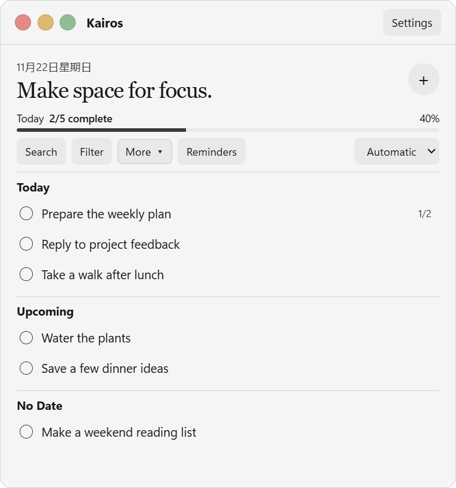
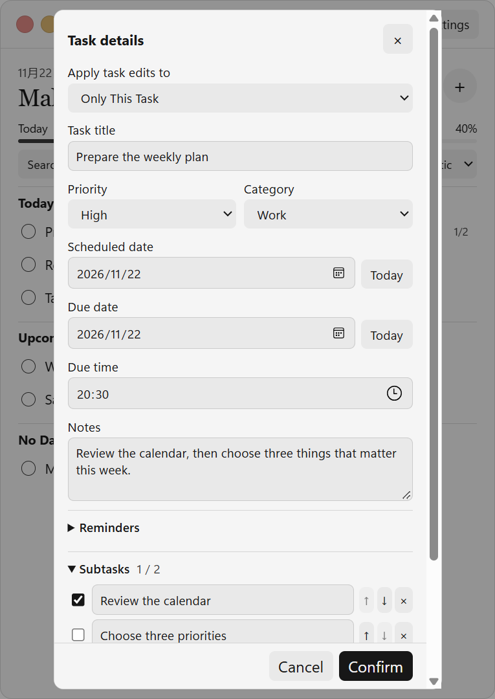
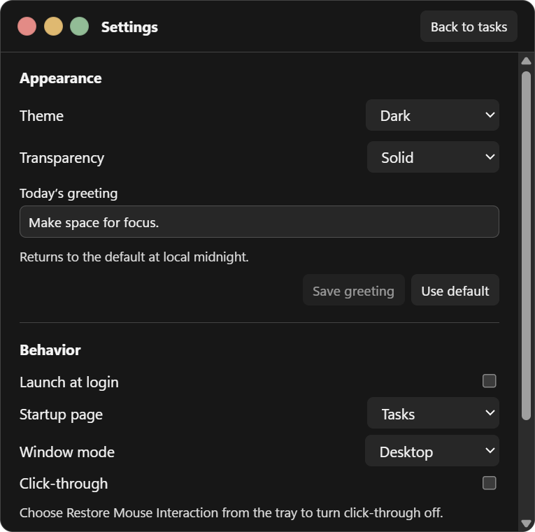

# Kairos

[简体中文](README.zh-CN.md)

**At your own pace.**

Kairos is a local-first personal task manager with previews for Windows 11 and Apple Silicon Macs. Its compact desktop panel keeps today's tasks within reach. Give a task a scheduled date to decide when to work on it, and a deadline to mark when it needs to be finished.

  

[Windows preview](#windows-preview) · [macOS preview](#macos-preview) · [Getting started](#getting-started) · [Build from source](#build-from-source)

## What you can do

- **Plan your day.** Add tasks quickly, group them into Today, Upcoming, or No Date, and organize them by priority and category.
- **Build routines.** Break a task into subtasks and repeat it daily, weekly, or monthly. Edit one occurrence or apply changes across its series.
- **Keep the panel where you work.** Move and resize the frameless window and choose a light or dark theme and a transparency level.
- **Keep task data on your PC.** Kairos stores tasks in a local SQLite database.

## Windows preview

The screenshots use sample data in the Windows 1.0.0 preview. The default branch tracks the verified desktop panel, core tasks, and recurrence. The preview also includes search and filters, Windows reminders, completion statistics, and local backup and restore.

| Task details | Settings in dark mode |
| --- | --- |
|  |  |

### Install a preview build

Download **Kairos_1.0.0_x64-setup.exe** from the release page, run it on an x64 Windows 11 PC, then open **Kairos** from the Start menu. [Download the Windows preview](https://github.com/YidanPan/Kairos/releases/tag/v1.0.0-preview.1)

The installer is unsigned, so Windows may display a SmartScreen prompt. Windows 11 normally includes WebView2. The installer downloads it if the runtime is missing. ARM64 has yet to be verified on hardware.

## macOS preview

Download **Kairos_1.0.0_aarch64.dmg** for an Apple Silicon Mac running macOS 12 or newer. Open the disk image and drag Kairos into Applications. The preview uses an ad hoc signature, and macOS may show a security notice on first launch. [Download the macOS preview](https://github.com/YidanPan/Kairos/releases/tag/v1.0.0-macos-preview.1)

## Getting started

1. Click **+** to add a task. The preview schedules new tasks for **Today**.
2. Open a task to edit its title, dates, notes, category, or repeat rule. In the preview, you can also change task reminders. Choose **Confirm** in the preview to save the changes together. **Cancel**, Esc, or closing the dialog discards the draft.
3. Select **Categories** on the task toolbar to manage categories. In the preview, find it under **More → Categories**. The preview also has **More → Statistics** for activity and **Reminders** for reviewing and snoozing notifications.
4. In the preview, open **Settings → Appearance** to set a greeting for the rest of the day. Kairos restores the default at local midnight.

### Windows controls and backups

In the preview, closing the window sends Kairos to the system tray so reminders can continue. Use the tray to reopen the panel, restore mouse interaction, or quit. **Settings → Behavior** controls launch at login, the startup page, and window modes.

| Preview shortcut | Action |
| --- | --- |
| Ctrl+Alt+Shift+T | Show or hide Kairos |
| Ctrl+Alt+Shift+N | Quick Add |
| Ctrl+Alt+Shift+F | Search |
| Ctrl+Alt+Shift+S | Open Settings |
| Ctrl+Alt+Shift+R | Restore mouse interaction |

Open **Settings → Data and backups** in the preview to create, export, or restore a snapshot. Kairos keeps up to 30 automatic daily backups in the active backup folder. **Merge** adds missing tasks and keeps local edits. **Replace** restores the snapshot's data and settings after saving a copy of the current data.

## Build from source

Use Windows 11, Node.js 22.13+ LTS, the stable Rust MSVC toolchain, Microsoft C++ Build Tools with the **Desktop development with C++** workload, and Microsoft Edge WebView2.

From the repository root, install dependencies and start the desktop app.

~~~powershell
npm ci
npm run tauri dev
~~~

Run the checks and build an optimized executable.

~~~powershell
npm run lint
npm test
npm run build
cargo test --manifest-path src-tauri/Cargo.toml --locked
npm run tauri build -- --no-bundle
~~~

On revisions with NSIS bundling enabled, **npm run tauri build** creates the installer in **src-tauri/target/release/bundle/nsis/**.

## Project links

- [Architecture and local data](docs/architecture.md)
- [Development and verification progress](docs/progress.md)
- [Product requirements](PRD.md)
- [Development workflow](DEVELOPMENT_RULES.md)
- [Issues](https://github.com/YidanPan/Kairos/issues)

## License

Kairos is available under the [MIT License](LICENSE).
