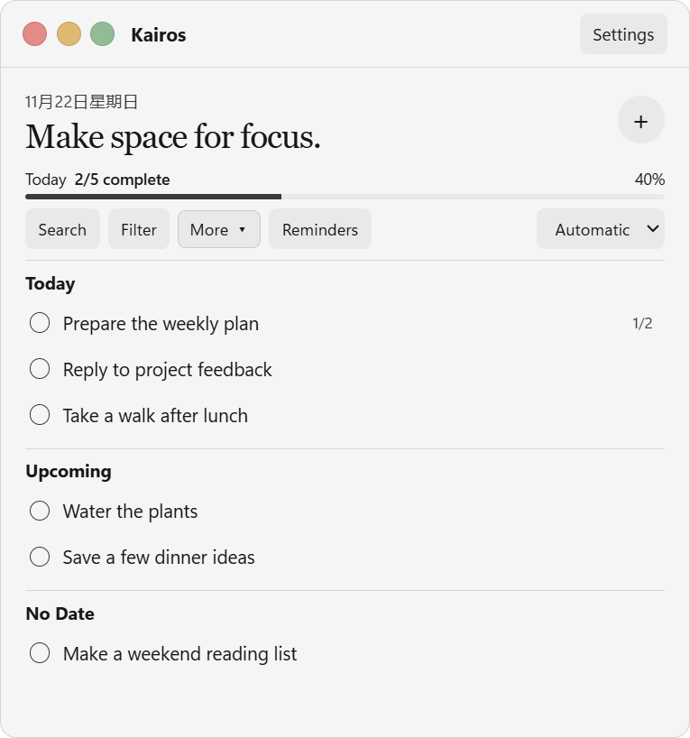
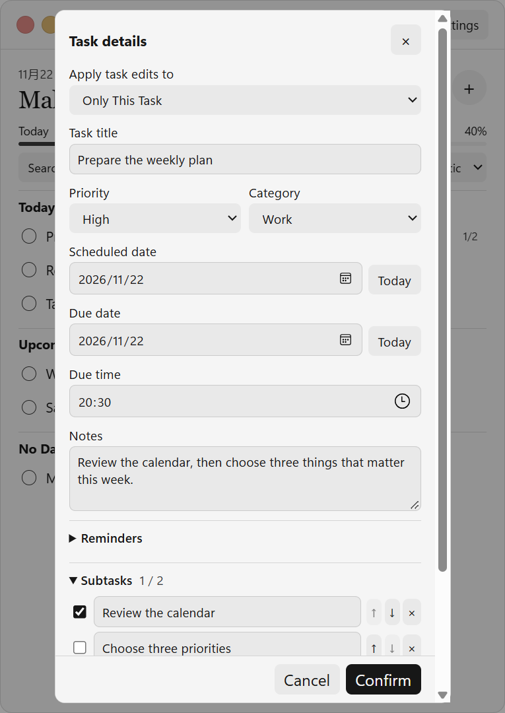
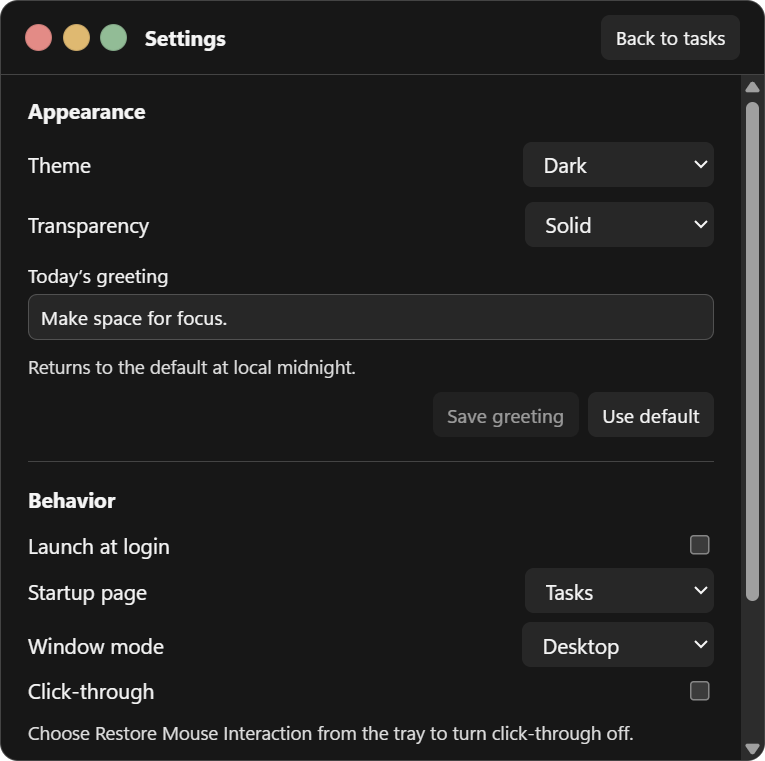

# Kairos

[English](README.md)

**按自己的节奏。**

Kairos 是一款面向 Windows 11 的个人任务管理器。紧凑的桌面面板让你随时查看今天要做的事。用计划日期安排哪天做，用截止日期标记最晚何时完成。任务数据保存在本机。

  

[Windows 预览版](#windows-预览版) · [快速上手](#快速上手) · [从源码构建](#从源码构建)

## 主要功能

- **安排每天的任务。** 快速添加任务，按今天、即将到来和未安排日期分组，也可以给任务设置分类和优先级。
- **管理重复事项。** 把任务拆成子任务，或设置为按天、周、月重复。可以修改单次任务，也可以将改动应用到整个系列。
- **调整桌面面板。** 拖动无边框窗口、调整尺寸，并按喜好选择浅色或深色主题和透明度。
- **在本机保存数据。** Kairos 使用本地 SQLite 数据库保存任务。

## Windows 预览版

截图来自 Windows 1.0.0 预览版，使用示例数据。默认分支包含已通过阶段验收的桌面面板、基础任务管理和重复任务。预览版还提供搜索和筛选、Windows 提醒、完成统计，以及本地备份和恢复。

| 任务详情 | 深色设置页 |
| --- | --- |
|  |  |

### 安装预览版

从发布页下载 **Kairos_1.0.0_x64-setup.exe**，在 Windows 11 x64 电脑上运行，安装后从开始菜单打开 **Kairos**。 [下载 Windows 预览版](https://github.com/YidanPan/Kairos/releases/tag/v1.0.0-preview.1)

安装包目前未签名，Windows 可能显示 SmartScreen 提示。Windows 11 通常自带 WebView2，缺少时安装程序会联网下载。ARM64 兼容性待实机验证。

## 快速上手

1. 点击 **+** 添加任务。预览版默认把新任务安排到 **Today（今天）**。
2. 打开任务可编辑标题、日期、备注、分类和重复规则。预览版还支持编辑提醒，所有改动通过底部的 **Confirm（确认）** 一次保存。点击 **Cancel（取消）**、按 Esc 或关闭弹窗都会放弃未确认的修改。
3. 通过工具栏的 **Categories（分类）** 管理分类。在预览版中，入口位于 **More → Categories**。还可以通过 **More → Statistics** 查看完成情况，通过 **Reminders** 查看提醒或稍后再提醒。
4. 在预览版的 **Settings → Appearance** 中可以自定义当天的问候语。Kairos 会在本地时间午夜恢复默认问候语。

### 窗口、快捷键和备份

关闭预览版窗口后，Kairos 会隐藏到系统托盘，继续发送提醒。可以通过托盘重新打开面板、恢复鼠标操作或退出应用。**Settings → Behavior** 中可设置登录时启动、启动页面和窗口模式。

| 预览版快捷键 | 功能 |
| --- | --- |
| Ctrl+Alt+Shift+T | 显示或隐藏 Kairos |
| Ctrl+Alt+Shift+N | 快速添加任务 |
| Ctrl+Alt+Shift+F | 搜索 |
| Ctrl+Alt+Shift+S | 打开设置 |
| Ctrl+Alt+Shift+R | 恢复鼠标操作 |

在预览版的 **Settings → Data and backups** 中可以创建、导出或恢复备份。Kairos 会在当前备份目录中保留最多 30 份每日自动备份。**Merge（合并）** 保留本机的修改，并补回备份中有而本机缺少的任务。**Replace（替换）** 会先备份当前数据，再恢复所选备份的数据和设置。

## 从源码构建

开发环境需要 Windows 11、Node.js 22.13+ LTS、稳定版 Rust MSVC 工具链、Microsoft C++ Build Tools（安装 **使用 C++ 的桌面开发** 工作负载），以及 Microsoft Edge WebView2。

在仓库根目录安装依赖并启动桌面应用。

~~~powershell
npm ci
npm run tauri dev
~~~

运行检查与测试，并构建优化后的可执行文件。

~~~powershell
npm run lint
npm test
npm run build
cargo test --manifest-path src-tauri/Cargo.toml --locked
npm run tauri build -- --no-bundle
~~~

在已启用 NSIS 打包的版本上，运行 `npm run tauri build` 会在 `src-tauri/target/release/bundle/nsis/` 生成安装包。

## 项目资料

- [架构与本地数据](docs/architecture.md)
- [开发和验收进度](docs/progress.md)
- [产品需求文档](PRD.md)
- [开发流程](DEVELOPMENT_RULES.md)
- [问题反馈](https://github.com/YidanPan/Kairos/issues)
